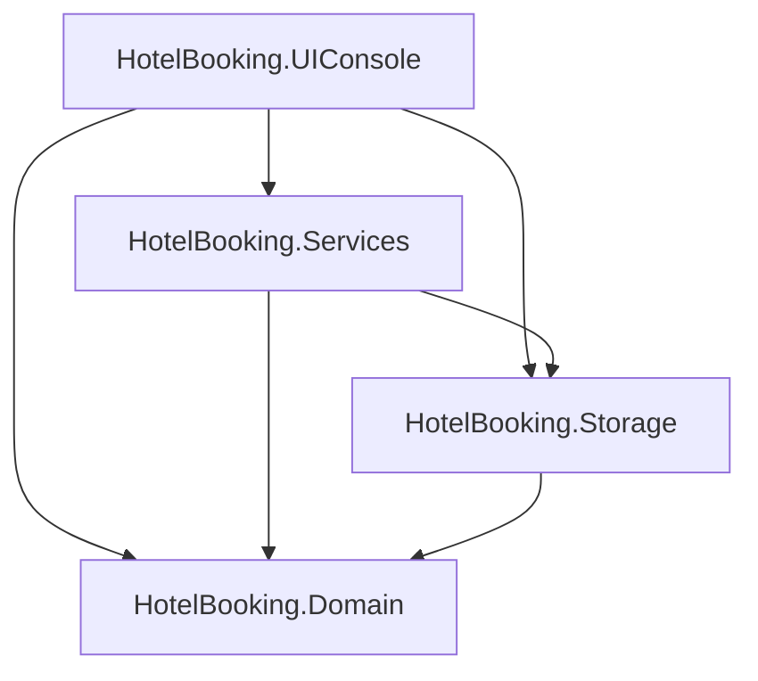

# HotelBooking

   

[](https://github.com/puzzlehead-dev/HotelBooking/actions/workflows/build.yml)

A console hotel booking system built with C# / .NET 9.

[Читать на русском](README.ru.md)

## Features

- Registration and login (user / administrator).
- Automatic completion of overdue bookings on startup.
- **User:**
  - Book a room: choose room type, start date, and number of days.
  - Cancel own booking (before or after approval).
  - View available room types for a given date or date range.
  - Receive notifications from the administrator about booking status.
  - View personal booking history.
  - View all personal bookings with sorting and filtering.
- **Administrator:**
  - Manage unprocessed booking requests (approve / reject).
  - Cancel an approved user booking.
  - View rooms with sorting, filtering, and search.
  - Add rooms, change status (open / closed), delete rooms.
  - View all bookings with sorting, filtering, and search.

## Tech Stack

- C# 13, .NET 9
- Console interface
- File-based storage (`Data/*.txt`, `|` separator)
- xUnit for tests
- No external dependencies in the main project; tests use xUnit and standard test packages

## Getting Started

Requires .NET 9 SDK.

Ways to run:
1. In a terminal: `dotnet run --project HotelBooking`
2. Open `HotelBooking.sln` in Visual Studio 2022, press `F5` (or `Ctrl+F5` to run without debugging).
3. In Rider: open `HotelBooking.sln`, press Run.

## Project Structure

```
HotelBooking.sln
├── HotelBooking/
│   ├── HotelBooking.Domain/       # entities and enums
│   ├── HotelBooking.Storage/      # data (files)
│   ├── HotelBooking.Services/     # business logic
│   ├── HotelBooking.UIConsole/    # console menus
│   └── Program.cs                 # entry point, dependency wiring
├── HotelBooking.Tests/            # xUnit tests
└── docs/                          # UML diagrams
```

## Architecture

Logical layers within a single project. Dependencies are unidirectional.



## Class Diagram

[Domain Class Diagram](docs/domain-class-diagram.svg)

## Tests

```bash
dotnet test
```

256 tests, all passing. Coverage: Domain, Storage, Services.

## Status

Educational project. Some decisions are intentional for the current scope: file-based storage instead of a database, plain-text passwords, no DI container. See [TECHDEBT.md](TECHDEBT.md) for the improvement plan.

## License

MIT — see [LICENSE](LICENSE).

## Contact

[@puzzlehead-dev](https://github.com/puzzlehead-dev)