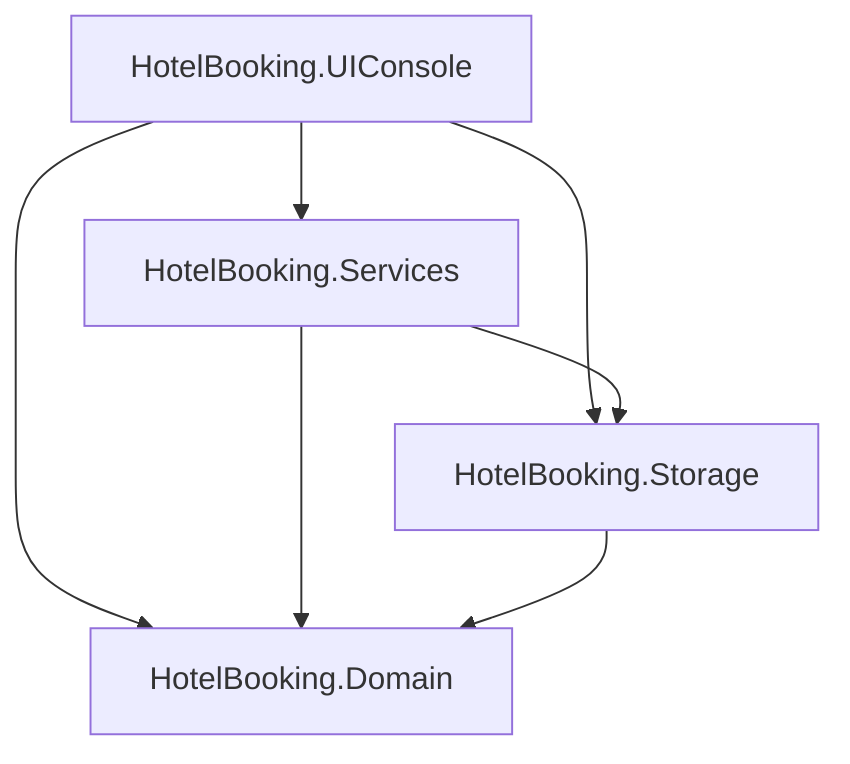

# HotelBooking

Консольное приложение для системы бронирования в отеле на C# / .NET 9

[Read in English](README.md)

## Возможности

- Регистрация и вход (пользователь / администратор)
- Автоматическое завершение просроченных броней при запуске приложения.
- Пользователь:
  - Бронирование номера: выбор типа, даты и количества дней брони.
  - Отмена своей заявки (до и после принятия)
  - Получение списка доступных типов номера на указанную дату или промежуток дней.
  - Получение уведомлений от администратора о статусе заявки.
  - Доступ к своей истории броней.
  - Доступ к списку всех своих броней с возможностью сортировки и фильтра.
- Администратор:
  - Управление необработанными заявками на бронь (принятие/отклонение).
  - Отмена принятой заявки пользователя
  - Просмотр номеров с сортировкой, фильтрацией и поиском.
  - Добавление, изменение статуса (открыт/закрыт), удаление номеров.
  - Просмотр всех заявок с сортировкой, фильтрацией и поиском

## Стек

- C# 13, .NET 9
- Консольный интерфейс
- Файловое хранилище (`Data/*.txt`, разделитель `|`)
- xUnit для тестов
- Основной проект без внешних зависимостей; тесты используют xUnit и стандартные тестовые пакеты

## Запуск

Требуется .NET 9 SDK

Способы:
1) В терминале: `dotnet run --project HotelBooking`
2) Откройте `HotelBooking.sln` в Visual Studio 2022, нажмите `F5` (или `Ctrl+F5` для запуска без отладки).
3) В Rider: откройте `HotelBooking.sln`, нажмите Run.

## Структура проекта

```
HotelBooking.sln
├── HotelBooking/
│   ├── HotelBooking.Domain/       # сущности и enum'ы
│   ├── HotelBooking.Storage/      # данные (файлы)
│   ├── HotelBooking.Services/     # бизнес-логика
│   ├── HotelBooking.UIConsole/    # консольные меню
│   └── Program.cs                 # точка входа, сборка зависимостей
├── HotelBooking.Tests/            # xUnit-тесты
└── docs/                          # UML-диаграммы
```

## Архитектура

Логические слои внутри одного проекта. Зависимости однонаправленные.



## Диаграмма классов

[Диаграмма классов Domain](docs/domain-class-diagram.svg)

## Тесты

```bash
dotnet test
```

Покрытие: Domain, Storage, Services, всего 256 тестов, все зелёные.

## Статус

Учебный проект. Часть решений принята осознанно для текущего масштаба: файловое хранилище вместо БД, пароли в открытом виде, без DI-контейнера. Планы по улучшению — в [TECHDEBT.md](TECHDEBT.md).

## Лицензия

MIT — см. [LICENSE](LICENSE)

## Контакты

[@puzzlehead-dev](https://github.com/puzzlehead-dev)
